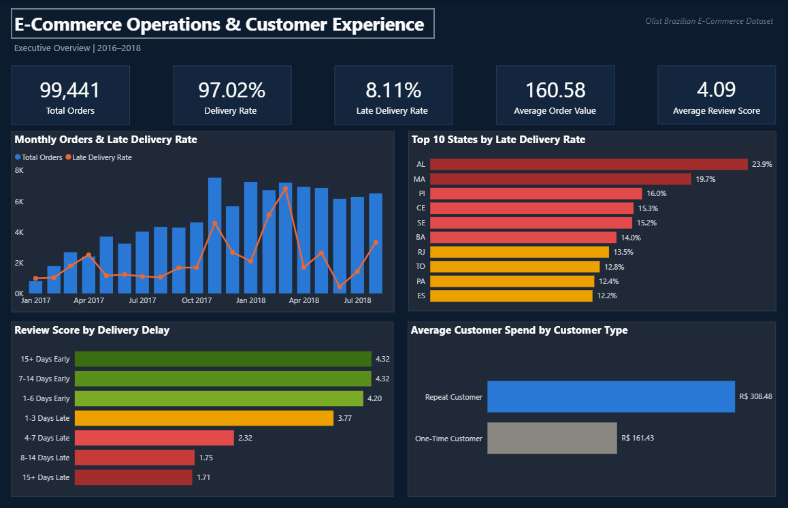
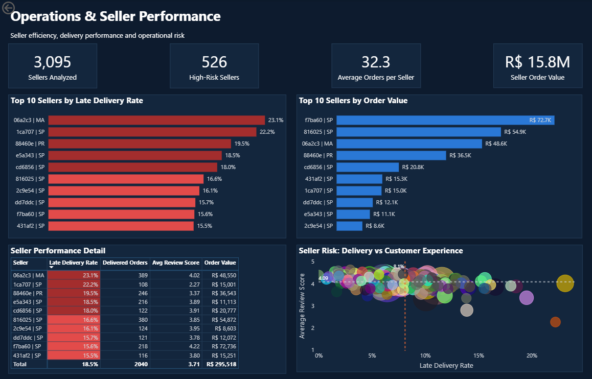
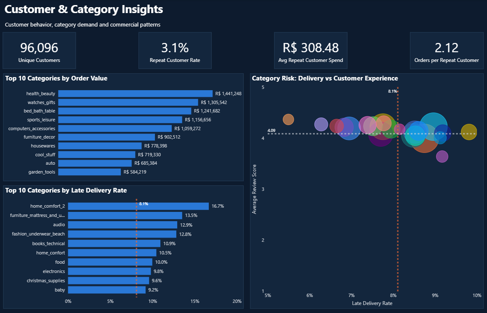
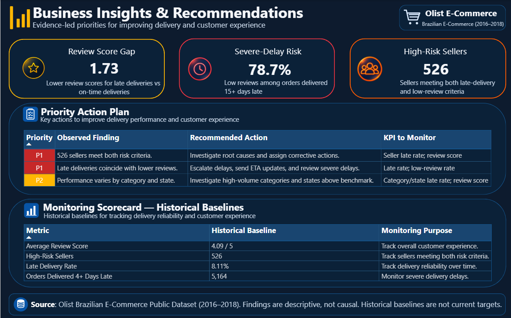

# Olist E-Commerce Operations & Customer Experience Analytics

An end-to-end data analytics project investigating delivery performance, seller risk, category demand, and customer experience using the Olist Brazilian E-Commerce Public Dataset (2016–2018).

The project uses Excel for data-quality investigation, SQL Server for data preparation and business analysis, and Power BI for interactive dashboards and decision-oriented reporting.

## Business Problem

**Which operational and commercial patterns are associated with poor customer experience, and where should the business prioritize improvement?**

Late deliveries, inconsistent seller performance, and differences across categories and regions can affect customer satisfaction. This project develops a structured view of these patterns and translates the findings into actionable recommendations.

## Project Objectives

- Evaluate order fulfilment and delivery performance.
- Investigate the relationship between delivery delays and customer review scores.
- Identify sellers with elevated late-delivery rates and below-benchmark review scores.
- Compare category and regional operational performance.
- Understand repeat-customer behaviour and customer spending.
- Build a reusable SQL analytical model and a four-page Power BI report.

## Tools & Technologies

- **Excel:** Data exploration, cleaning checks, missing-value analysis, and data-quality documentation.
- **SQL Server / T-SQL:** Data validation, aggregation, joins, views, KPI calculations, and business analysis.
- **Power BI Desktop:** Interactive dashboards, DAX measures, visual formatting, and business insights.
- **Power Query:** Data import and transformation.
- **GitHub:** Version control and project documentation.

## Dataset

Source: [Olist Brazilian E-Commerce Public Dataset on Kaggle](https://www.kaggle.com/datasets/olistbr/brazilian-ecommerce)

The dataset covers Brazilian e-commerce orders from 2016–2018 and includes order, order-item, payment, review, product, seller, customer, geolocation, and category-translation data.

The source data is not included in this repository at this stage. Refer to the original dataset source for download and usage terms.

## Analytical Workflow

1. **Data discovery and cleaning:** Examined missing values, duplicates, invalid chronology, and other quality issues. Documented cleaning decisions and retained meaningful missing values rather than replacing them indiscriminately.
2. **SQL data modelling:** Built an order-level analytical master table and aggregated item, payment, and review data before joining to avoid row multiplication.
3. **Business analysis:** Investigated delivery delays, review scores, seller performance, category demand, geography, freight burden, and repeat-customer behaviour.
4. **Power BI reporting:** Developed a four-page report covering executive performance, operations and seller risk, customer and category insights, and business recommendations.
5. **Decision support:** Translated descriptive findings into prioritized actions and suggested monitoring metrics.

## Key Findings

The following figures reflect the current project analysis and its documented KPI definitions.

| Finding | Result |
|---|---:|
| Total orders | 99,441 |
| Delivered orders | 96,478 |
| Delivery rate | 97.02% |
| Project late-delivery benchmark | 8.11% |
| Average order value | R$160.58 |
| Average review score | 4.09 / 5 |
| Average freight burden | 20.88% |
| Unique customers | 96,096 |
| Repeat-customer rate | 3.12% |
| Average repeat-customer spend | R$308.48 |
| Review-score gap: on-time vs. late deliveries | 1.73 points |
| Low-review rate among orders 15+ days late | 78.7% |
| Sellers meeting both risk criteria | 526 |

### Important interpretation

- Late deliveries are associated with substantially lower review scores in this dataset.
- Sellers classified as high risk have a late-delivery rate above the 8.11% project benchmark and an average review score below 4.09.
- The 78.7% low-review rate refers to orders delivered at least 15 days late; low reviews are defined as scores of 1 or 2.
- The results are descriptive and do not establish that delivery delays alone caused lower review scores.

## Power BI Report Pages

1. **Executive Overview** — headline KPIs, monthly orders and late-delivery trends, state performance, delivery-delay experience, and customer spending.
2. **Operations & Seller Performance** — seller rankings, seller-level risk analysis, and performance detail.
3. **Customer & Category Insights** — customer KPIs, category order value, category delivery risk, and the category risk scatter plot.
4. **Business Insights & Recommendations** — evidence cards, the priority action plan, and a monitoring scorecard.

The four dashboard screenshots are embedded below, and the downloadable Power BI report is available in the v1.0.0 release. will be added to this repository as the portfolio packaging is completed.

## Data Quality and Limitations

- The dataset does not contain cost of goods sold (COGS), so profit and profit margin were not calculated.
- Order-item value and payment value were kept separate where reconciliation differences existed.
- Missing dates and chronology anomalies were documented instead of silently corrected.
- Review scores were treated as ordinal ratings for descriptive comparisons.
- Review comments are predominantly in Portuguese; comment sentiment analysis is outside the scope of this project.
- Findings represent the historical 2016–2018 dataset, not current Olist operating performance.

## Project Status

The four dashboard screenshots are embedded below, the SQL analysis scripts are organised in the `sql/` folder, the cleaning decision log is available under `docs/`, and the downloadable Power BI report is published in the `v1.0.0` release.

## Dashboard Preview

### Page 1 — Executive Overview

### Page 2 — Operations & Seller Performance

### Page 3 — Customer & Category Insights

### Page 4 — Business Insights & Recommendations

## Download the Power BI Dashboard

[Download Olist_Ecommerce_Operations_Dashboard.pbix](https://github.com/vineethbathula343/olist-ecommerce-operations-analytics/releases/download/v1.0.0/Olist_Ecommerce_Operations_Dashboard.pbix)

Open the file using Power BI Desktop. Refreshing the report may require configuring the SQL Server connection for your environment.

